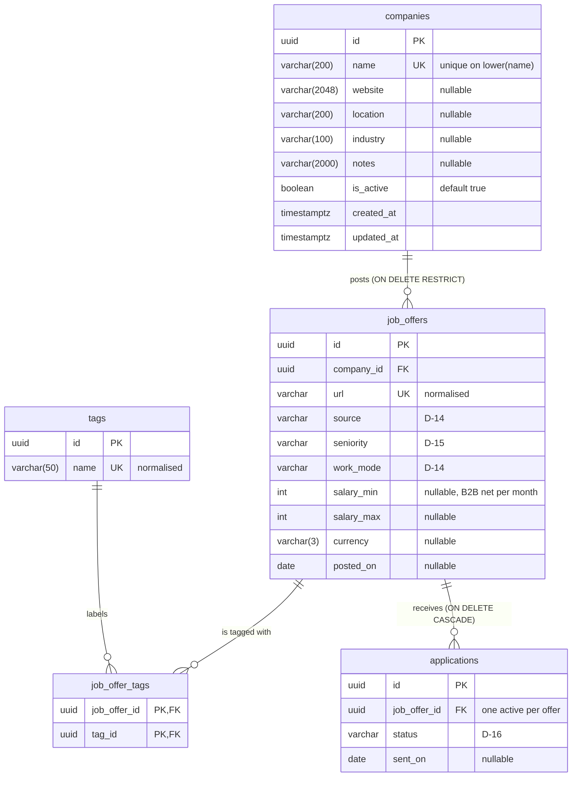

# Data model

Tables and the relationships between them. Decisions referenced as `D-XX` are in
[`decisions.md`](decisions.md); the order of work is in [`roadmap.md`](roadmap.md).

| Table | Status |
|---|---|
| `companies` | Implemented (stage 2, step 1) |
| `job_offers`, `tags`, `job_offer_tags` | Planned (stage 2, step 2) |
| `applications` | Planned (stage 2, step 3) |

Columns of the planned tables are a sketch based on the decisions so far; their exact
names, types and required fields are decided in their own step and this file is updated
then. Keep the diagram in sync with the models whenever a migration changes the schema.

Every table also gets `created_at` and `updated_at` from `TimestampMixin`; they are shown
only for `companies` to keep the diagram readable.

## Relationships

| From | To | Cardinality | On delete of the parent | Decisions |
|---|---|---|---|---|
| `companies` | `job_offers` | one company, many offers | `RESTRICT`: companies are never deleted, only deactivated; offers of an inactive company are hidden from lists | D-04, D-10 |
| `job_offers` | `tags` | many to many, through `job_offer_tags` | the offer's links to tags are deleted; tags stay | D-09 |
| `job_offers` | `applications` | one offer, many applications over time, at most one active | `CASCADE`: deleting an offer deletes its applications | D-04, D-06, D-16 |

## Uniqueness

| Table | Rule | Enforced by | Decisions |
|---|---|---|---|
| `companies` | name, regardless of case | unique index `uq_companies_lower_name` on `lower(name)` | D-05 |
| `job_offers` | normalised URL | unique constraint | D-05 |
| `tags` | normalised name | unique constraint | D-09 |
| `applications` | one active application per offer | partial unique index on `job_offer_id` for non-final statuses | D-06, D-16 |
